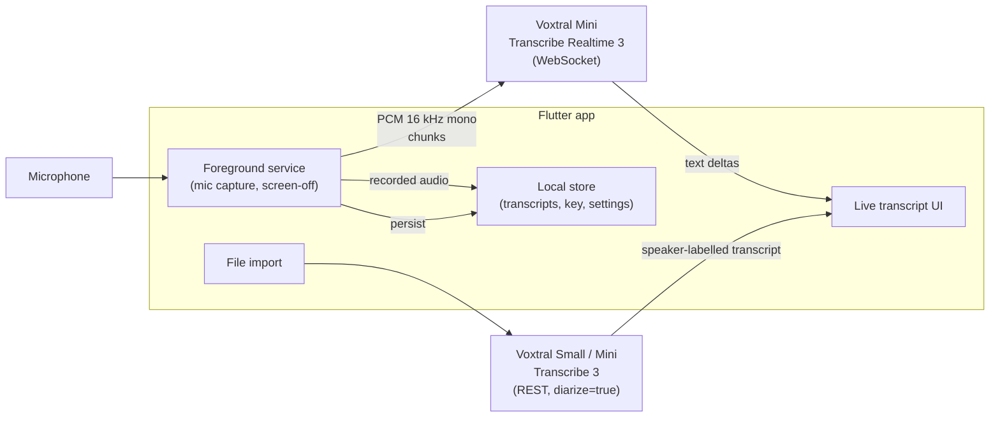

# Voxtral Live Transcription App — Project Plan

**Project type:** Personal / hobby app, built with Flutter
**Developer profile:** Experienced developer, working solo
**Budget:** Free / hobby tier (BYO Mistral API key — users pay only for what they transcribe)

---

## 1. Vision

**One-liner:**
> *"An app that transcribes live conversations (or uploaded audio files) into clean, speaker-labelled text — powered by the user's own Mistral API key."*

**Guiding principle:** small scope, polished execution. The app does two things extremely well:

1. **Live capture** — record realtime audio (including background/screen-off), stream it to Voxtral Mini Transcribe Realtime 3, and show the conversation as text on screen.
2. **File transcription** — upload/import an audio file and transcribe it with Mistral Speech-to-Text, with speaker attribution.

---

## 2. Scope Definition

### In Scope (v1.0 — Minimum Lovable Product)
- Live recording + realtime transcription via WebSocket streaming
- Background capture: audio continues while app is backgrounded or screen is off (Android foreground service)
- Live transcript view: text appears as it is spoken, grouped into conversation turns
- Speaker attribution: user can see *who* is speaking (see §4 — the diarization caveat)
- Import audio file (from device storage) → transcribe → view transcript with speaker labels
- Settings screen: enter/replace Mistral API key, model preferences, language hints
- Local transcript history (saved on device, exportable to text/Markdown)
- Light + dark theme, minimalistic modern UI in Mistral orange

### Explicitly Out of Scope (v1)
- Accounts / own backend — the app talks to Mistral's API directly
- Cloud sync of transcripts
- Text-to-speech / voice agents (Voxtral 3 has it, but it's not this app)
- iOS (architecture allows it later; ship Android first, validate, then port)
- Sending transcripts to a Mistral agent (v2 — see §9)

> ✂️ **Rule of thumb:** every temptation to expand v1 goes into the "v2 ideas" note instead. Ship first.

---

## 3. Architecture

**Key decision — speaker attribution is two different problems:**

| Mode | What you get | How |
|---|---|---|
| Live | Realtime text via WebSocket, but **no diarization** (Mistral docs: realtime is not compatible with the `diarize` parameter) | Stream audio to the realtime model *and* keep the recorded audio. On stop, run a **post-session batch pass** with diarization on the saved audio to produce the speaker-attributed final transcript |
| File upload | Speaker labels out of the box | Batch transcription with `diarize=true` (Voxtral Small Transcribe 3 = flagship diarization; Mini = cheaper) |

Practical v1 simplification for live mode: show the raw live text as it streams (turn segments separated by end-of-turn detection), then swap in the diarized, speaker-labelled transcript when the session is finalized.

---

## 4. Tech Stack

| Layer | Choice | Why |
|---|---|---|
| Framework | **Flutter (Dart)** | Your pick; single codebase, good streaming/async support |
| State management | **Riverpod** (or Bloc) | Stream-friendly — realtime text deltas map naturally to reactive UI |
| Mic capture | **`record`** package (PCM 16 stream) | Streams raw PCM16 to Dart while recording; pairs with foreground service |
| Background capture | **`flutter_foreground_task`** + Android foreground service with `microphone` type | Keeps capture alive screen-off; required by Android 11+ mic restrictions |
| Realtime STT | **`web_socket_channel`** → `wss://api.mistral.ai/v1/audio/transcriptions/realtime` | No official Dart SDK; the WebSocket protocol is simple (send audio bytes, receive text deltas) |
| Batch STT / file upload | **`dio`** (multipart POST) | Same story: small REST client instead of an SDK |
| API key storage | **`flutter_secure_storage`** | Keystore-backed encryption; never in shared prefs or source |
| Local data | **Drift** (SQLite) or Isar | Transcript history with search, export |
| Testing | `flutter_test` + `mocktail` | Mock the WebSocket/REST layer from day one |

**Voxtral 3 reference points (verify exact model IDs against the model catalog before wiring code):**

- Realtime: `wss://api.mistral.ai/v1/audio/transcriptions/realtime?model=voxtral-mini-transcribe-realtime-2602`, audio as `pcm_s16le` @ 16 kHz mono, configurable latency 80–2400 ms, built-in end-of-turn detection, context biasing
- Batch: REST transcription endpoint, `diarize=true` supported, context biasing, long-audio support, 50+ languages
- Pricing (user's own key): realtime ≈ $0.008/min, Mini batch ≈ $0.0035/min, Small batch ≈ $0.004/min → **build a live "session minutes / est. cost" indicator** so BYO-key users are never surprised

---

## 5. Design (look & feel)

- **Minimalistic & modern:** generous whitespace, few UI elements, typography-led hierarchy (e.g. Inter/General Sans style), no visual chrome that isn't functional
- **Mistral orange (`#FF7000`) as the primary/accent color in both light and dark mode**; neutrals stay restrained (near-white / near-black surfaces, mid-grey secondary text); orange used sparingly for accents, active recording state, and CTAs so it stays striking
- Material 3 themes with `#FF7000` as seed color; define both themes upfront, not as an afterthought
- Transcript UI: chat-bubble-like blocks per turn, speaker name/avatar chip above each block; live words appear with a subtle fade-in; "finalized" diarized text visually distinct from provisional streaming text (e.g. lighter grey → solid)
- Recording state must be unmistakable: pulsing orange indicator + persistent notification while backgrounded

---

## 6. Milestones

### Phase 0 — Spike: the riskiest pieces first *(1–2 weekends)*
- [x] Flutter project, Git repo, Material 3 scaffold with orange light/dark themes
- [x] **Spike A — realtime path:** mic → PCM16 stream → Mistral realtime WebSocket → text on screen. Nothing else. This proves the core.
- [x] **Spike B — background capture:** same pipeline running via foreground service with screen off for 30+ min without Android killing it
- [x] **Spike C — batch path:** hard-coded file → batch transcription with `diarize=true` → speaker-labelled output

### Phase 1 — Live mode end-to-end *(2–3 weekends)*
- [x] Robust WebSocket lifecycle: reconnect on network drops, buffer audio during disconnects, graceful stop/end-of-turn handling
- [x] Foreground service polished: notification, pause/resume, battery sanity check
- [x] Live transcript UI with turn grouping; save session audio + transcript locally
- [x] Post-session diarization pass → speaker-labelled final transcript replaces provisional one

### Phase 2 — File mode + settings *(1–2 weekends)*
- [ ] File import (file picker) → transcribe with speaker labels → transcript view
- [ ] API key entry/validation screen (validate with a cheap test request); secure storage
- [ ] Session minutes + estimated cost indicator; model choice (Small vs Mini) per transcription
- [ ] Transcript history, export to text/Markdown, share sheet

### Phase 3 — Polish & hardening *(1–2 weekends)*
- [ ] Empty/error states (no key, no mic permission, no network, API errors, quota)
- [ ] Audio focus handling (don't capture during phone calls; respect other media apps)
- [ ] Unit tests on the WebSocket/REST layer with mocks; one integration test of the live flow
- [ ] Wake-lock + battery review for long sessions; app icon in orange

### Phase 4 — Ship & iterate *(ongoing, guilt-free)*
- [ ] Dogfood for 2–4 weeks; keep a friction list
- [ ] v1.1 from the top friction points; pull from v2 ideas only when motivated

---

## 7. Security, Privacy & Compliance

| Concern | Approach |
|---|---|
| API key | User-provided, stored in secure storage, sent only to `api.mistral.ai` over TLS. Never in logs, crash reports, or app source |
| Audio & transcripts | Stays local by default; audio deleted after diarization pass (configurable); be explicit in UI about *where* audio goes |
| Permissions | `RECORD_AUDIO` runtime prompt + foreground-service-with-mic on Android 11+; explain *why* at prompt time |
| Play Store (if published) | Background mic access triggers strict review — prepare a demo video + clear policy statement of what's recorded and that it's sent to Mistral |
| Privacy policy | Needed for Play distribution: app handles mic + user API key + Mistral processing; free generators exist, keep it honest |

---

## 8. Risks & Mitigations

| Risk | Mitigation |
|---|---|
| **Scope creep** (the #1 hobby-app killer) | Frozen v1 scope; v2 ideas note; ship before expanding |
| **Realtime ≠ diarization** (hard API constraint) | Hybrid design already in §3 — don't burn weekends trying to force it; revisit when Mistral updates the API |
| Android killing background capture (OEM battery managers are aggressive — Xiaomi/Huawei/etc.) | Foreground service + documented "exclude from battery optimization" onboarding step; test on your own device early |
| Battery drain from continuous streaming + WebSocket | It's inherent; offer a "quality vs. battery" chunking setting; measure in Phase 3 |
| API/protocol churn — Voxtral 3 just released, model IDs and features will move | Isolate all Mistral client code in one layer with interfaces; pin model IDs in config |
| No official Dart SDK — you maintain your own client | Client is small (one WebSocket, one REST call); mock it in tests; copy event shapes from docs |
| WebSocket drops mid-session | Reconnect + local audio buffer replay; never lose already-streamed text |
| Burnout | Timeboxed weekends; Phase 0 spikes prove the fun part first |

---

## 9. Future Ideas (parking lot — do not build in v1)

**Mistral agent integration:** after a session, let the user send the transcript to a Mistral agent they've configured in their account (summarize, extract action items, file notes…). Keep v1's data model export-friendly so this is a drop-in feature. Check the Studio Agents API surface when you get there.

**Automatic speaker naming:** batch diarization already yields "Speaker 1 / Speaker 2" segments. The v2 idea: let users rename speakers once, store a local speaker profile, and (if Mistral exposes matching/enrollment later) map known voices to names automatically in future captures. Interim trick: feed known speaker names as **context biasing** keyphrases so transcription at least spells names correctly. Watch this space — Voxtral 3 moves fast.

**Other candidates:** live translation (Small Transcribe 3 supports it), widgets/quick-start tile, Wear OS companion, iOS port, on-device wake word to start sessions.

---

## 10. Distribution (free budget)

| Route | Cost | Notes |
|---|---|---|
| Sideloading (GitHub Releases) | Free | APK artifacts; fine for personal + friends |
| F-Droid | Free | App must be FOSS; their build pipeline handles reproducible builds |
| Google Play | $25 one-time | Background-mic review (see §7) is the main hurdle |

Recommendation: GitHub Releases first; Play when it earns it.

---

## 11. Success Criteria (hobby edition)

- ✅ You use it in a real multi-person conversation and the transcript is genuinely useful
- ✅ 30-min background session survives screen-off on your phone
- ✅ Estimated session cost is visible before/during use
- ✅ Codebase you'd still enjoy opening in 6 months
- 🎁 Stretch: a stranger finds it and says thanks

---

## Next Actions

1. Read the Voxtral 3 realtime + speech-to-text docs and confirm current model IDs and event shapes
2. Get a Mistral API key, test the realtime WebSocket from a 20-line Dart script (Phase 0, Spike A)
3. Set up the Flutter project with both orange themes so everything you build looks right from day one